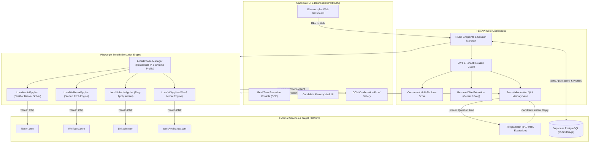

<div align="center">

# ⚡ AutoApply AI: Autonomous Multi-Portal Job Agent

**Production-grade autonomous job application engine engineered with stealth Playwright browser orchestration, verified anti-bot cloaking (residential profile persistence), zero-hallucination screening questionnaire solving (Candidate Memory Vault), and tamper-evident DOM submission proofs.**

[](https://www.python.org/)
[](https://fastapi.tiangolo.com)
[](https://playwright.dev)
[](https://ai.google.dev/)
[](https://groq.com)
[](https://supabase.com)
[](https://pytest.org)
[](LICENSE)

[🚀 Quick Start](#-quick-start) • [Supported Platforms](#-supported-platforms-matrix) • [Architecture](#-system-architecture) • [Engineering Highlights](#-engineering-highlights) • [Testing](#-testing--quality-assurance)

</div>

---

## 💡 Executive Summary

Traditional job hunting is plagued by redundant 40-question recruiter questionnaires, external redirect mazes, and aggressive anti-bot defenses (Akamai, Cloudflare) that instantly ban cloud datacenter IPs. Generic form autofillers fail because they emit blind clicks and claim false-positive successes without verifying real submission.

**AutoApply AI** solves this by uniting:
1. **Local Stealth Browser Execution:** Drives a genuine Chromium instance from your authentic residential IP using fingerprint-cloaked Playwright, effortlessly passing Akamai and Cloudflare checks without CAPTCHAs.
2. **Multi-Portal Autonomous Appliers:** Specialized engines for **Naukri.com**, **Wellfound (AngelList)**, **LinkedIn Easy Apply**, and **Y Combinator (Work at a Startup)**.
3. **Zero-Hallucination Memory Vault:** Candidate facts (CTC, notice period, tech stack experience) are strictly matched and never fabricated by the LLM. Semantic conflict filters mathematically prevent polarity collisions (e.g., *Current CTC* vs. *Expected CTC*).
4. **Tamper-Evident Proof Protocol:** Never marks a job as applied until the physical DOM renders an unambiguous submission confirmation, simultaneously capturing a high-resolution screenshot and execution log.
5. **24/7 Telegram HITL Fallback:** When an unseen recruiter question appears, the agent notifies you via Telegram, records your response, submits the form, and permanently saves the answer to your private vault.

---

## 📊 Supported Platforms Matrix

| Platform | Automation Vector | Anti-Bot Evasion | Form & Questionnaire Solvers | Verification Output |
| :--- | :--- | :--- | :--- | :--- |
| **Naukri.com** | Chatbot Drawer SPA, Single-Click Apply & External ATS Detection | Akamai edge cookie scrubbing (`_abck`, `bm_sz`), session pre-warming | Numeric CTC inputs, notice period selectors, radio chips, experience fields | DOM submission modal screenshot (`proof_naukri_*.png`) |
| **Wellfound (AngelList)** | Dynamic Application Modals & Recruiter Pitches | Cloudflare Turnstile evasion, authenticated session handoff | Custom tailored pitch generator, salary expectations, tech skill notes | Recruiter dialog confirmation screenshot (`proof_wellfound_*.png`) |
| **LinkedIn** | Multi-Page Easy Apply Modal Wizard | Persistent residential browser profile, fingerprint normalization | Contact info, work authorization checkboxes, numeric years of experience | "Application Sent" confirmation dialog screenshot (`proof_linkedin_*.png`) |
| **Y Combinator (WaaS)** | Work at a Startup Application Forms & Founders Notes | Direct authenticated session, anti-fingerprint CDP masking | "Why this startup?" AI pitch, candidate bio sync, compensation alignment | Submitted modal confirmation screenshot (`proof_yc_*.png`) |

---

## 🏗 System Architecture



---

## ⚡ Engineering Highlights

### 1. Zero-Captcha Residential Playwright Engine
Datacenter IPs are flagged by Akamai and Cloudflare within milliseconds. AutoApply executes via a persistent, fingerprint-cloaked Playwright instance on your residential network:
- Removes `navigator.webdriver` flags and standard automation signatures.
- Reuses authenticated Chrome profiles (`local_browser_profile/`) to eliminate repeated 2FA/login hurdles.
- Emulates realistic human typing cadence with randomized jitter ($80\text{ms} - 250\text{ms}$) and natural mouse movements.

### 2. Zero-Hallucination Q&A Memory Vault
Recruiters disqualify candidates whose applications contain inconsistent numbers. The Memory Vault enforces strict truthfulness:
- **Never Synthesizes Financials:** Current CTC, expected compensation, and notice periods must come from candidate-verified records.
- **Semantic Polarity Conflict Filtering:** Mathematical stop-word pruning preserves domain-critical keywords (`current`, `expected`, `fixed`, `variable`, `notice`, `relocate`). If a question asks for *Expected CTC*, the engine strictly forbids matching a record containing *Current CTC*.
- **Skill Modifier Differentiation:** Distinguishes nuanced variants (e.g., *React.js* vs. *React Native*) to prevent incorrect experience attributions.

### 3. Multi-Tier Resilient LLM Router
The agent coordinates multiple LLMs via non-blocking asynchronous clients with automated failover:
$$\text{Gemini 2.0 Flash} \longrightarrow \text{Gemini 1.5 Pro} \longrightarrow \text{Groq LPU (Qwen 2.5 / Llama 3.3)}$$
Transient rate limits (HTTP 429), regional outages (HTTP 503), or API schema rotations gracefully step down to the next provider without interrupting active browser submissions.

### 4. Tamper-Evident DOM Proof Protocol
Unlike naive bots that claim success upon clicking a button, AutoApply validates full DOM mutations:
- Waits for explicit confirmation elements (e.g., `#application-success`, `.apply-message-success`, `.artdeco-modal__header`).
- Captures full-resolution viewport snapshots saved with unique timestamp hashes: `proof_<platform>_<timestamp>.png`.
- Proofs are surfaced immediately on the local dashboard and persisted for candidate auditability.

### 5. Multi-Tenant Telegram HITL Escalation
When an entirely new question appears during live automation:
1. The agent captures the question, context, and available options (radio chips / dropdown values).
2. Dispatches a high-priority alert to your private Telegram chat with action buttons.
3. Upon your reply, the agent injects the answer into the live browser form, completes submission, and permanently saves your choice to the Memory Vault.

---

## 📂 Project Structure

```text
ai-job-agent/
├── backend/
│   ├── app/
│   │   ├── agents/                   # High-level AI agents (JobScout, CoverLetterAgent, ResumeAnalyst)
│   │   ├── auth/                     # Supabase JWT authentication & tenant security
│   │   ├── database/                 # SQLAlchemy & Supabase models
│   │   ├── llm/                      # Multi-tier LLM router & Gemini service
│   │   ├── memory/                   # Conflict-aware screening Q&A Memory Vault
│   │   ├── notifications/            # Telegram HITL listener & multi-channel alerts
│   │   ├── parsers/                  # PDF, DOCX, and TXT resume DNA extractors
│   │   ├── scrapers/                 # Specialized scrapers (Naukri, Wellfound, LinkedIn, YC)
│   │   └── utils/                    # Cookie normalizers and validation helpers
│   ├── data/
│   │   ├── live_naukri_catalog.json  # Seed catalog of verified tech openings
│   │   └── sample_resume.*           # Test fixtures for resume parsing
│   ├── main.py                       # Core FastAPI application & REST router
│   └── requirements.txt              # Pinned production dependencies
├── frontend/
│   ├── index.html                    # Modern glassmorphic SPA dashboard
│   ├── static/js/app.js              # State machine, real-time SSE console, proof gallery
│   └── vercel.json                   # Edge reverse proxy configuration
├── local_agent/
│   ├── browser_manager.py            # Stealth Playwright browser lifecycle & session manager
│   ├── naukri_applier.py             # Naukri chatbot drawer & modal flow automation
│   ├── wellfound_applier.py          # Wellfound pitch & application automation
│   ├── linkedin_applier.py           # LinkedIn Easy Apply multi-page wizard automation
│   ├── yc_applier.py                 # Y Combinator Work at a Startup automation
│   ├── session_setup.py              # Interactive 4-portal session authentication utility
│   ├── job_scout.py                  # Real-time multi-platform job scout
│   ├── cli.py                        # Autonomous command-line application runner
│   ├── server.py                     # Standalone local agent server
│   ├── config.py                     # Path configuration & environment loader
│   └── candidate_profile.json        # Local candidate preferences & skills
├── extension/                        # Manifest V3 Chrome extension for 1-click session sync
├── tests/                            # Professional test suite (scrapers, vault, API, auth)
│   ├── test_api_endpoints.py         # FastAPI health, search, and frontend serving tests
│   ├── test_cookie_normalizer.py     # Cookie normalization & WAF sanitization tests
│   ├── test_memory_vault.py          # Keyword pruning & semantic conflict tests
│   └── test_scrapers.py              # Platform scraper & data model tests
├── supabase/
│   └── schema.sql                    # Production PostgreSQL schema with Row-Level Security
├── start_local.bat                   # 1-Click Windows launcher (Dashboard + Local Server)
├── start_agent.bat                   # 1-Click CLI launcher
├── Dockerfile                        # Production container (Noble Playwright v1.49.0)
├── docker-compose.yml                # Multi-service orchestration configuration
└── README.md                         # Senior engineering documentation
```

---

## 🚀 Quick Start

### 1. Prerequisites
- **Python 3.11+** installed
- **Google Chrome** installed (used for authentic residential sessions)
- Free Google Gemini API Key ([Google AI Studio](https://aistudio.google.com/))

### 2. Installation
```bash
# Clone the repository
git clone https://github.com/Sachin-dev001/ai-job-agent.git
cd ai-job-agent

# Create and activate virtual environment
python -m venv backend/venv
source backend/venv/bin/activate       # On Linux/macOS
backend\venv\Scripts\activate          # On Windows

# Install pinned dependencies
pip install -r backend/requirements.txt

# Install Playwright browser binaries
playwright install chromium
```

### 3. Environment Configuration
Copy `.env.example` to `.env` in the root and `backend/` directory:
```bash
cp .env.example backend/.env
```
Populate your credentials:
```env
PORT=8000
PROJECT_NAME="AutoApply AI Agent"
VERSION="2.5.0"

# LLM Provider Keys
GEMINI_API_KEY="your-gemini-api-key"
GROQ_API_KEY="your-optional-groq-key"

# Telegram Bot (Optional for mobile HITL alerts)
TELEGRAM_BOT_TOKEN="your-bot-token"
TELEGRAM_CHAT_ID="your-chat-id"

# Security
SERVER_AUTH_SECRET="your-32-character-secret"
```

### 4. Connect Portal Sessions (One-Time Setup)
Run the session setup tool to log into your portals once. Playwright saves your persistent residential session locally:
```bash
python -m local_agent.session_setup
```
Select the portals you wish to connect (**Naukri**, **Wellfound**, **LinkedIn**, **Y Combinator**). A Chrome window will open—simply log in and close the browser.

### 5. Launch the Local Web Dashboard
Double-click **`start_local.bat`** (Windows) or execute:
```bash
python -m uvicorn main:app --host 127.0.0.1 --port 8000 --app-dir backend
```
Open **`http://localhost:8000`** in your browser to access:
- **Connection Badges:** Real-time session status for all 4 platforms.
- **Interactive Scout:** Filter fresh tech roles ($\le 15$ days) and trigger 1-click auto-apply.
- **Live Playwright Console:** Real-time log streaming of DOM interactions.
- **Proof Gallery:** High-resolution zoomable DOM confirmation screenshots.

---

## 💻 CLI Mode (Headless / Terminal Dispatch)

You can also run AutoApply directly from the terminal or automate scheduled cron runs:

```bash
# Launch interactive CLI
python -m local_agent.cli

# Direct apply to a single target job URL
python -m local_agent.cli --apply "https://www.naukri.com/job-listings-..."

# Auto-scout and apply to top 5 matching Python / GenAI openings
python -m local_agent.cli --auto --keyword "GenAI Engineer" --limit 5
```

---

## 🧪 Testing & Quality Assurance

AutoApply includes a standard test suite powered by `pytest` verifying scrapers, data models, memory vault logic, and API endpoints:

```bash
# Run complete test suite
pytest tests/ -v
```

### Test Suite Coverage:
- `test_cookie_normalizer.py`: Validates Netscape, JSON, and header formats; ensures WAF cookies (`_abck`, `bm_sz`) are filtered.
- `test_memory_vault.py`: Validates stop-word preservation, semantic polarity conflict detection (*Current* vs. *Expected* CTC), and answer retrieval.
- `test_scrapers.py`: Validates `ScrapedJob` pydantic models and live search routines for LinkedIn and Y Combinator.
- `test_api_endpoints.py`: Validates FastAPI health checks, job search endpoints, and frontend static mounting.

---

## 🔒 Security, Privacy & Ethical Automation

- **Zero Plaintext Credential Storage:** AutoApply never asks for or stores account passwords. Authentication relies entirely on locally cached residential session cookies.
- **Tenant Data Isolation:** Memory Vault entries and proof screenshots are strictly partitioned by authenticated `user_id`. Path traversal vectors are guarded with `os.path.basename` validation.
- **Polite Execution Rate Limiting:** All automated browser interactions incorporate non-linear human delays ($1.5\text{s} - 4.0\text{s}$) to avoid triggering portal rate limits.
- **Ethical Automation Notice:** AutoApply is engineered as a personal career accelerator and application organizer. Users should review and comply with the terms of service of each target platform.

---

## 📜 License

Distributed under the **MIT License**. See `LICENSE` for more details.
