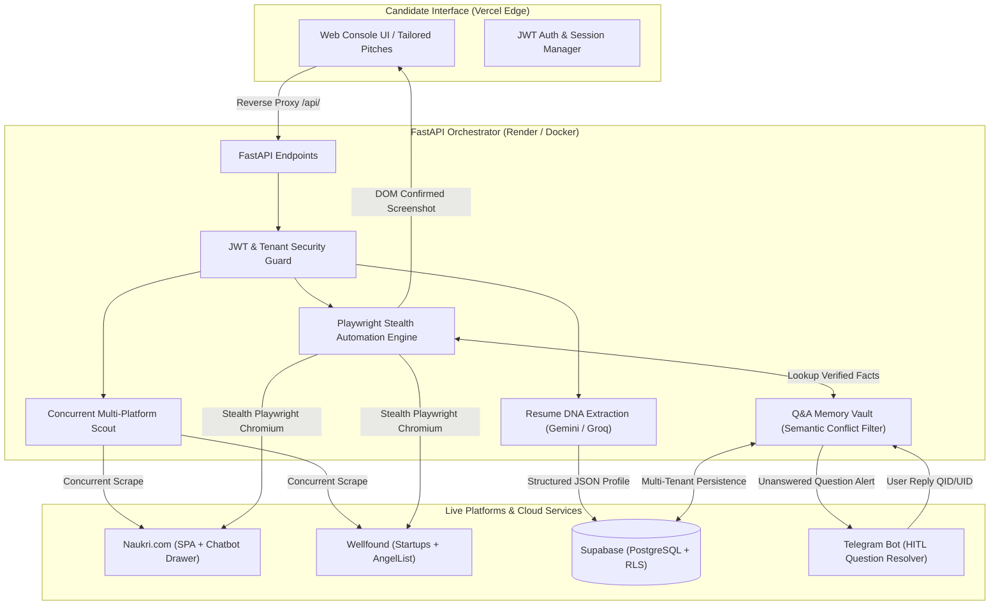

<div align="center">

# ⚡ AutoApply: Personal Autonomous Playwright Job Agent

**Personal, multi-platform autonomous AI agent that scouts, matches, and automatically applies to tech jobs on Naukri.com and Wellfound using local Playwright automation with your genuine residential IP, zero bot challenges, intelligent screening Q&A answering, and timestamped screenshot proofs.**

[](https://playwright.dev)
[](https://www.python.org/)
[](https://www.google.com/chrome/)
[](https://fastapi.tiangolo.com)

[🚀 1-Click Quickstart](#-quick-start---personal-local-agent) • [Architecture](#-architecture) • [Features](#-key-features)

</div>

---

## 🚀 Quick Start - Personal Local Agent

Running the agent locally on your PC bypasses datacenter IP blocks (Akamai / Cloudflare bot challenges) completely and allows full native control over Chrome, file uploads, and screening questions.

### 🌟 1. Launch the Local Web Dashboard (Recommended)
Simply double-click **`start_ui.bat`** or run:
```bash
python -m local_agent.server
```
Your browser will automatically open **`http://localhost:8000`** with the full interactive UI:
- **Status Badges:** Live connection status for Naukri and Wellfound.
- **1-Click Connect Accounts:** Launches Chrome so you can log into Naukri and Wellfound once.
- **1-Click Direct Auto-Apply:** Paste any job link, toggle live headed Chrome view, and click Launch!
- **Smart Job Scout:** Search live tech roles on Naukri and click "Auto-Apply" row by row.
- **Live Playwright Execution Console:** Real-time terminal streaming of browser actions, button clicks, and questionnaire answering.
- **Submission Proof Gallery:** View and zoom full-resolution DOM confirmation screenshots.

---

### 💻 2. Command-Line Interface (Alternative)
You can also run the agent directly in terminal or double-click **`start_agent.bat`**:
```bash
# Launch interactive menu
python -m local_agent.cli

# One-time login setup
python -m local_agent.cli --setup

# Apply to a specific job URL
python -m local_agent.cli --apply "https://www.naukri.com/job-listings-..."

# Auto-scout and apply to matching roles
python -m local_agent.cli --auto --keyword "Python Developer" --limit 5
```

---

## 📖 Table of Contents

- [Overview](#-overview)
- [System Architecture](#-system-architecture)
- [Core Capabilities](#-core-capabilities)
  - [1. Playwright Stealth Auto-Apply Engine](#1-playwright-stealth-auto-apply-engine)
  - [2. Multi-Tier LLM Architecture](#2-multi-tier-llm-architecture)
  - [3. Zero-Hallucination Q&A Memory Vault](#3-zero-hallucination-qa-memory-vault)
  - [4. Multi-Tenant Telegram HITL Escalation](#4-multi-tenant-telegram-hitl-escalation)
  - [5. Visual Verification & Proofs](#5-visual-verification--proofs)
- [Tech Stack](#-tech-stack)
- [Project Structure](#-project-structure)
- [Quick Start & Local Setup](#-quick-start--local-setup)
- [Environment Configuration](#-environment-configuration)
- [Production Deployment](#-production-deployment)
- [API Reference](#-api-reference)
- [Security & Isolation](#-security--isolation)
- [License & Disclaimer](#-license--disclaimer)

---

## 🔍 Overview

**AutoApply** is an autonomous full-stack AI agent engineered to eliminate the repetitive friction of technical job hunting. Unlike basic scraping scripts or form autofillers that emit unverified success messages, AutoApply drives a real headless Chromium instance with browser fingerprint cloaking, handles complex multi-step recruiter questionnaire drawers, learns candidate preferences without hallucinating numbers, and captures cryptographic, timestamped DOM submission screenshots.

It operates seamlessly on **100% free-tier cloud infrastructure** (Vercel Edge, Render / Hugging Face Spaces, Supabase PostgreSQL, and Google AI Studio).

---

## 🏗 System Architecture



---

## 🚀 Core Capabilities

### 1. Playwright Stealth Auto-Apply Engine
- **Client-Side SPA Hydration:** Intelligently warms up domain sessions on `naukri.com` to seed Akamai sensor cookies (`_abck`, `bm_sz`) and waits for React SPA root containers (`#root`) to mount the physical `#apply-button` before evaluating candidates.
- **Dynamic Redirect Recovery:** If a curated job slug rotates or redirects to a multi-listing search page, the runner automatically discovers active job tuples or conducts an automated on-platform search to open the live direct opening.
- **Accurate Portal Classification:** Distinguishes 1-click direct apply listings (`Apply`) from external corporate ATS listings (`Apply on company site`), preventing false-positive submissions and generating tailored pitches for manual submissions.
- **Multi-Step Questionnaire Drawer Resolution:** Autonomously steps through recruiter chatbot dialogs, answering textual experience fields, numeric metrics, radio chips, and select dropdowns.

### 2. Multi-Tier LLM Architecture
- **Non-Blocking Async Engine:** Built with `httpx.AsyncClient` with a 25-second resilience timeout, ensuring the ASGI event loop thread is never blocked during structured JSON extraction.
- **Native System Instructions:** Utilizes Google AI Studio's native `systemInstruction` payload structure rather than simulated multi-turn conversational hackarounds.
- **Resilient Multi-Model Failover:**
  $$\text{gemini-flash-lite-latest} \longrightarrow \text{gemini-flash-latest} \longrightarrow \text{gemini-pro-latest} \longrightarrow \text{Groq LPU (Qwen / GPT-OSS)}$$
  Transient rate limits (HTTP 429), spikes (HTTP 503), and alias deprecations (HTTP 404) gracefully fail over down the chain without stopping execution.

### 3. Zero-Hallucination Q&A Memory Vault
- **Strict Anti-Hallucination Policy:** Recruiter questions (e.g., current CTC, notice period, fixed vs. variable compensation) are never fabricated by the LLM. Answers must originate from verified candidate inputs.
- **Semantic Polarity Conflict Detection:** Regex stop-word pruning preserves domain-critical qualifiers (`years`, `experience`, `per`, `annum`, `lacs`, `current`, `expected`, `fixed`, `variable`, `native`). Conflicting question polarities (e.g., *Current CTC* vs. *Expected CTC*, or *React Native* vs. *React.js*) are mathematically prevented from colliding.
- **Atomic Concurrency:** Disk and database synchronizations employ atomic file replacements (`os.replace`) and async locks to prevent corruption across concurrent container tasks.

### 4. Multi-Tenant Telegram HITL Escalation
- When an unseen recruiter question appears during an automated application, the agent pauses execution and alerts the candidate via **Telegram**.
- Outgoing alerts embed structured multi-tenant tracking tags: `[QID:<question_id> | UID:<user_id>]`.
- Candidate replies on Telegram are parsed, resolved back to the active Playwright task, answered on the live page, and stored permanently in the user's private vault for future applications.

### 5. Visual Verification & Proofs
- Once Naukri or Wellfound confirms submission on the live DOM, the runner captures a full-resolution screenshot proof.
- Proofs are saved in tenant-isolated paths (`/proofs/<user_id>/proof_<timestamp>.png`) and served via protected endpoints that check authentication ownership.

---

## 🛠 Tech Stack

| Domain | Technology | Purpose |
| :--- | :--- | :--- |
| **Backend API** | [FastAPI](https://fastapi.tiangolo.com/) | High-performance async ASGI REST API |
| **Automation** | [Playwright Python](https://playwright.dev/) + Stealth | Headless Chromium automation & bot evasions |
| **LLM Orchestration** | [Google Gemini](https://ai.google.dev/) + [Groq](https://groq.com/) | Structured resume parsing & pitch tailoring |
| **Persistence** | [Supabase](https://supabase.com/) (PostgreSQL) | Multi-tenant auth, user sessions & Q&A memories |
| **Frontend Client** | Vanilla JS (ES6+) + Tailwind CSS + Lucide | Responsive glassmorphic dashboard |
| **Edge Routing** | [Vercel](https://vercel.com/) | Reverse proxy rewrites (`/api/*`, `/proofs/*`) |
| **HITL Alerts** | Telegram Bot API (`python-telegram-bot`) | Real-time question escalation & answer learning |
| **Keep-Alive Engine** | [UptimeRobot](https://uptimerobot.com/) | 5-minute HTTP polling to prevent cold starts |

---

## 📂 Project Structure

```text
ai-job-agent/
├── Dockerfile                         # Production Noble Chromium container
├── sync_cookies_to_cloud.py          # Session cookie sync utility
├── backend/
│   ├── main.py                        # FastAPI entrypoint & protected routes
│   ├── requirements.txt               # Pinned dependencies (Playwright v1.49.0)
│   ├── app/
│   │   ├── config.py                  # Pydantic environment configuration
│   │   ├── agents/
│   │   │   ├── job_scout.py           # Multi-platform job aggregator
│   │   │   ├── naukri_live_runner.py  # Playwright live runner for Naukri
│   │   │   ├── wellfound_live_runner.py # Playwright runner for Wellfound
│   │   │   ├── resume_analyst.py      # LLM resume DNA extractor
│   │   │   └── cover_letter_agent.py  # AI pitch & application generator
│   │   ├── auth/
│   │   │   └── auth_handler.py        # Supabase JWT & tenant authorization
│   │   ├── database/
│   │   │   ├── models.py              # Application schemas
│   │   │   └── supabase_client.py     # Cloud database client & fallback
│   │   ├── llm/
│   │   │   ├── gemini_service.py      # Async Gemini engine with failover
│   │   │   └── router.py              # Multi-provider LLM dispatcher
│   │   ├── memory/
│   │   │   └── qa_vault.py            # Conflict-aware screening Q&A memory
│   │   ├── notifications/
│   │   │   ├── notifier.py            # Multi-channel HITL dispatcher
│   │   │   └── telegram_listener.py   # Interactive Telegram polling listener
│   │   ├── parsers/                   # PDF, DOCX, and TXT parsing utilities
│   │   └── scrapers/                  # Platform scrapers (Naukri, Wellfound)
│   └── scripts/                       # E2E test suites & diagnostic tools
└── frontend/
    ├── index.html                     # Single-page web dashboard
    ├── vercel.json                    # Edge proxy rules & CORS avoidance
    └── static/
        ├── css/style.css              # Custom styling
        └── js/app.js                  # Frontend state machine & fetch wrapper
```

---

## ⚡ Quick Start & Local Setup

### 1. Prerequisites
- Python 3.11+
- Node.js (optional, for local frontend serving)
- Google Gemini API Key ([Get one free](https://aistudio.google.com/))
- Telegram Bot Token & Chat ID ([via @BotFather](https://t.me/BotFather))

### 2. Clone and Install
```bash
git clone https://github.com/Sachin-dev001/ai-job-agent.git
cd ai-job-agent

# Create virtual environment
python -m venv backend/venv
source backend/venv/bin/activate  # On Windows: backend\venv\Scripts\activate

# Install dependencies
pip install -r backend/requirements.txt

# Install Playwright Chromium binaries
playwright install chromium
playwright install-deps chromium
```

### 3. Configure Environment
Create a `.env` file in the `backend/` directory:
```env
PORT=8000
PROJECT_NAME="AutoApply AI Agent"
VERSION="1.0.0"

# LLM Providers
GEMINI_API_KEY="your-gemini-api-key"
GROQ_API_KEY="your-groq-api-key"

# Multi-Tenant Cloud Database (Optional for local mode)
SUPABASE_URL="https://your-project.supabase.co"
SUPABASE_ANON_KEY="your-supabase-anon-key"
SUPABASE_SERVICE_ROLE_KEY="your-supabase-service-key"

# Telegram Human-In-The-Loop Notifications
TELEGRAM_BOT_TOKEN="your-bot-token"
TELEGRAM_CHAT_ID="your-chat-id"

# Security
SERVER_AUTH_SECRET="your-32-byte-random-jwt-secret"
```

### 4. Run Locally
```bash
# Start FastAPI ASGI server
cd backend
python -m uvicorn main:app --reload --port 8000
```
Open `http://localhost:8000/docs` to inspect the Swagger UI, or serve `frontend/` using any local static web server.

---

## 🌐 Production Deployment

### 1. Backend Container (Render / Hugging Face Spaces)
The repository includes an optimized `Dockerfile` based on `mcr.microsoft.com/playwright/python:v1.49.0-noble`.
- Connect your GitHub repo to **Render** or create a **Hugging Face Docker Space** (16GB RAM free tier).
- Set the environment variables in your cloud dashboard.
- Set Health Check path to `/api/health`.

### 2. Frontend Edge (Vercel)
- Deploy the repository to **Vercel** with the root directory set to `frontend`.
- [`frontend/vercel.json`](frontend/vercel.json) automatically proxies `/api/*` and `/proofs/*` to your backend without cross-origin preflight overhead.

### 3. Keep-Alive Configuration (UptimeRobot)
Free cloud instances (such as Render) spin down after 15 minutes of inactivity. Set up a free HTTP monitor on **UptimeRobot**:
- **URL:** `https://your-backend.onrender.com/api/health`
- **Interval:** 5 minutes
- **Monitoring Type:** HTTP(s)

---

## 📡 API Reference

| Method | Endpoint | Description | Auth Required |
| :--- | :--- | :--- | :---: |
| `GET` | `/api/health` | Service health & database connectivity | No |
| `POST` | `/api/auth/register` | Register a new tenant candidate account | No |
| `POST` | `/api/auth/login` | Authenticate and receive JWT bearer token | No |
| `POST` | `/api/resume/analyze` | Parse resume document and extract skills DNA | No |
| `POST` | `/api/jobs/scout` | Concurrent real-time scouting across platforms | Yes |
| `POST` | `/api/naukri/apply-single` | Execute Playwright apply to a single Naukri job | Yes |
| `POST` | `/api/wellfound/apply-single`| Execute Playwright apply to a Wellfound job | Yes |
| `GET` | `/api/proofs/{uid}/{file}` | Securely retrieve submission proof screenshot | Yes* |
| `POST` | `/api/session/connect-cookies`| Connect session cookies for cloud background apply | Yes |
| `GET` | `/api/memory/vault` | Retrieve verified candidate Q&A memories | Yes |
| `POST` | `/api/memory/vault` | Add/update verified screening answer | Yes |

*\*Guest/demo proof paths are accessible for testing; tenant user proofs require ownership validation.*

---

## 🔒 Security & Isolation

- **Zero-Storage of Plaintext Credentials:** Portal passwords are never stored. The runner uses encrypted session cookies exported from an authenticated residential session.
- **Tenant Path Isolation:** All application proof screenshots are saved under tenant-specific directories, with path traversal sanitization (`os.path.basename`) and JWT owner verification.
- **WAF Bypass Hygiene:** Akamai edge cookies (`_abck`, `bm_sz`) are scrubbed before browser context injection, allowing fresh residential cookies to handshake without triggers.

---

## 📄 License & Disclaimer

This project is licensed under the **MIT License**.

> **Disclaimer:** AutoApply is intended for personal career development and automated job tracking. Please review and adhere to the Terms of Service of target platforms (Naukri.com, Wellfound). Use responsible application rates to prevent account restrictions.
